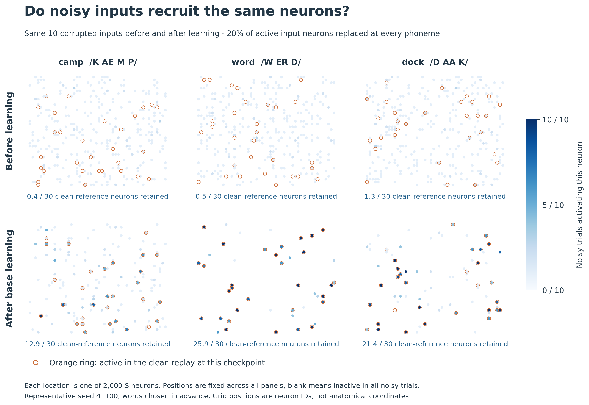
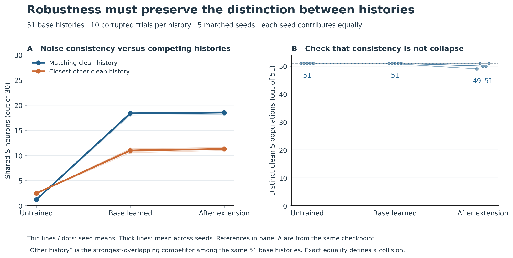
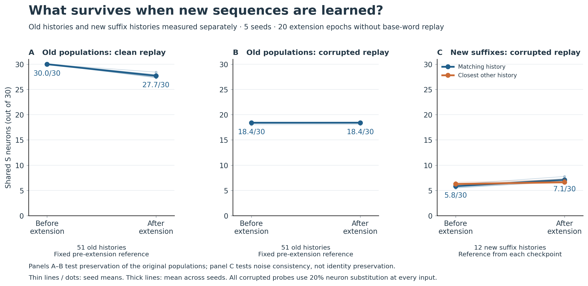

# Neuronal populations under corruption and continual extension

2026-09-22 — replacement for the earlier three structure figures.

The question is now explicit: **does learning make variable inputs recruit the appropriate population, without erasing distinctions between histories—and does that property survive extension?** These figures measure S populations directly, not output classification or a two-dimensional embedding.

## 1. See what learning does to individual neurons



**What we do.** For three words selected before running the experiment, replay ten independently corrupted inputs before and after base training. The actual corrupted inputs are matched across checkpoints. Every phoneme has six of its thirty active input neurons replaced. Each position in the map is one of the 2,000 S neurons and stays fixed across every panel. Darker blue means the neuron participates in more noisy trials; orange rings mark the thirty neurons active in that checkpoint's clean replay. Unmarked blank positions were inactive in all ten noisy trials.

**What it shows.** Before learning, the corrupted inputs recruit widely varying populations, mostly unrelated to the clean reference. After learning, activity becomes more concentrated on the appropriate population. For seed 41100, mean clean-reference membership rises from **0.4 to 12.9 neurons for camp**, **0.5 to 25.9 for word**, and **1.3 to 21.4 for dock**, out of thirty. The imperfect camp example is retained rather than replaced by a more successful example.

**Why it is useful.** The reader can see the neuronal effect of learning, rather than infer it from recognition accuracy. The map makes clear what population consistency means: particular neurons are repeatedly recruited despite input corruption. The grid is an ordering of neuron IDs, not anatomical position. Clean reference membership may change between checkpoints; this figure tests robustness to a checkpoint's own clean response, not preservation of the original untrained population.

[PDF](population_robustness_2026_09_22/01_neurons_under_corruption.pdf) · [SVG](population_robustness_2026_09_22/01_neurons_under_corruption.svg)

## 2. Check that consistent populations still distinguish histories



**What we do.** Across all 51 distinct nonempty base histories, compare every corrupted response with (blue) its matching clean population and (orange) the most strongly overlapping *other* clean history. Repeat for five matched seeds. The right panel counts distinct clean populations, so consistency cannot be mistaken for every input converging to one assembly.

**What it shows.** Base learning raises overlap with the matching clean population from **1.22 to 18.40 of thirty neurons**. The strongest competing overlap also rises, but only to **10.99**. All **51/51 clean base populations remain distinct** in every seed after base learning. After extension, matching overlap remains high, but clean distinctness falls to **49–51 populations**, depending on seed. The plot deliberately includes those collisions.

| Stage | Matching history, shared neurons | Strongest other history, shared neurons | Distinct clean base populations |
|---|---:|---:|---:|
| Untrained | 1.22 ± 0.05 | 2.47 ± 0.02 | 51 on every seed |
| Base learned | 18.40 ± 0.22 | 10.99 ± 0.33 | 51 on every seed |
| After extension | 18.55 ± 0.24 | 11.31 ± 0.26 | 49–51 |

Values are mean ± sample standard deviation across five seed means. The fraction of noisy probes with *strictly greater* overlap with the matching population than any other base history rises from **12.0% to 84.5%** after base learning, then is **82.6%** after extension. This is a population-reference diagnostic, not native W recognition accuracy.

**Why it is useful.** It separates three otherwise easily conflated claims: a deterministic clean response exists; it tolerates population-code corruption; and it remains distinguishable from other histories. Distinct clean populations already exist before learning. The supported learning benefit here is greatly improved history-specific consistency under corruption, not creation of distinguishability from nothing. Exact distinctness alone does not imply large separation, which is why the competitor measurements are shown too.

[PDF](population_robustness_2026_09_22/02_robustness_and_separation.pdf) · [SVG](population_robustness_2026_09_22/02_robustness_and_separation.svg)

## 3. Separate preservation of old populations from learning new suffixes



**What we do.** Panel A measures clean old-history populations against their fixed pre-extension references. Panel B uses those same original references for noisy old-history replays. Panel C separately measures the twelve new suffix histories against their own clean references at each checkpoint, alongside the strongest competitor among all 63 histories.

**What it shows.** Old clean populations retain **27.71 ± 0.47 of thirty original neurons** on average after extension. An average of **32/51 old populations** remain exactly unchanged (range 28–36 across seeds). Under corruption, overlap with the *original* old populations stays at **18.40 before versus 18.41 after extension**. Thus robust access to old representations is largely preserved even though some membership changes.

The new suffix histories are much less noise-consistent: matching overlap increases only from **5.83 ± 0.31 to 7.10 ± 0.44 neurons**, while strongest competing overlap increases from **6.28 to 6.64**. Their robustness is not comparable to the base histories in this protocol. These suffix histories are also longer and have different exposure; the figure does not isolate the cause of that gap.

**Why it is useful.** A new clean reference could hide representational drift. Holding the old reference fixed in A–B avoids that mistake. Keeping new histories separate in C prevents the strong old-state result from masking weak robustness of new continuations. Panel A starts at thirty by definition; it is the post-extension value that measures preservation. Panel C is not a preservation metric because its reference changes with the checkpoint.

[PDF](population_robustness_2026_09_22/03_population_preservation.pdf) · [SVG](population_robustness_2026_09_22/03_population_preservation.svg)

## Experimental scope and validation

- **Physically four areas:** I, A, S, W; N = 2,000, k = 30, core β = 0.003, readout β_W = 0.40. Matched initial graphs use the established context-ablation builder.
- **Training:** 28 base words for 25 shuffled epochs, then eight extension words for twenty epochs without base-word replay. Prefix plasticity is externally disabled on the known prefix during extension; suffix plasticity remains enabled. These are learned extensions, not zero-shot predictions.
- **Seeds:** 41100, 41200, 41300, 41400, 41500. The illustrative word maps use seed 41100; aggregate plots include all five.
- **Sampling:** 63 unique nonempty phoneme histories: 51 base and twelve new suffix histories. Shared prefixes are deduplicated. Each history is replayed from reset, with ten noisy trials at each of three checkpoints: untrained, base learned, and post-extension. The study therefore records 9,450 noisy population probes plus 945 clean probes.
- **Noise:** exactly six of thirty active input neurons are replaced by randomly chosen inactive neurons at *every* phoneme. Activity remains fixed-k. Random draws are matched across checkpoints within each seed. This is continuous population-code corruption, not a single transient pulse, substituted phonemes, recorded speech, or recovery after corruption is removed.
- **Frozen evaluation:** both plasticity and normalization are disabled. Sparse synaptic-weight data hashes are unchanged by each full probe block on every seed. Activity is reset before every history.
- **Aggregation:** means give each unique history and noise trial equal weight within a seed, then each seed equal weight. Histories are not additional independent network replicates. Different history lengths are pooled; this is not a length-controlled robustness experiment.
- **References:** old-history competitors in Figure 2 come from the fixed set of 51 base histories. New-history competitors in Figure 3 come from all 63 histories. References are finite observed samples, not an exhaustive state-space search.
- **Independent checks:** every post-base and post-extension clean prefix population exactly matches the earlier independently captured four-area-equivalent diagnostic. Four unit tests verify the prefix partition, exact overlap counts, removal of self-comparison, and detection of genuine population collisions.

These figures support population-level robustness and substantial, imperfect preservation within the tested training budget. They do **not** establish basin geometry, autonomous error correction, indefinite continual stability, or flawless intermediate state separation. The weaker result on new suffixes remains visible rather than being absorbed into a pooled mean.

## Files and reproduction

Code: `/home/johnh/Documents/ac-fsm-learning/population_robustness_figures.py`.

Run from that repository, repeating capture for all five seeds:

```sh
OPENBLAS_NUM_THREADS=1 OMP_NUM_THREADS=1 MPLCONFIGDIR=/tmp/ac-population-mpl PYTHONDONTWRITEBYTECODE=1 python population_robustness_figures.py capture --seed 41100
OPENBLAS_NUM_THREADS=1 MPLCONFIGDIR=/tmp/ac-population-mpl PYTHONDONTWRITEBYTECODE=1 python population_robustness_figures.py render
OPENBLAS_NUM_THREADS=1 MPLCONFIGDIR=/tmp/ac-population-mpl PYTHONDONTWRITEBYTECODE=1 python -m unittest test_population_robustness_figures -v
```

The figure folder contains PNG/PDF/SVG exports, five compressed population captures, five parameter/provenance manifests, the per-seed measurements, and neuron-by-neuron illustrative frequencies. Rendering validates clean populations against `diagnostics/context/core_beta_0.003/features_*.npz`. The existing ignored ablation helper, pinned CMUdict file, and sibling PYAC source are also required; preserve them when packaging the experiment.

The previous three figures and their note have been removed from the active results directory and preserved under `archive/2026-09-22-first-figures/`. No earlier user figures or other research notes were removed.
