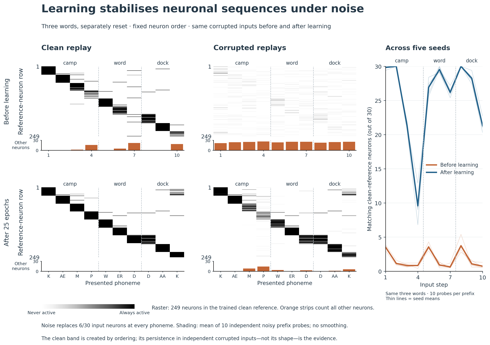

# Prototype: an ordered neuronal population raster

This is one candidate figure, not another replacement suite. It puts sequential population activity in the foreground and the quantitative check beside it.



[PDF](sequence_raster_prototype_2026_09_22/phoneme/sequence_raster.pdf) · [SVG](sequence_raster_prototype_2026_09_22/phoneme/sequence_raster.svg)

## How to read it

Columns follow the phonemes of **camp**, **word**, and **dock**. Dashed separators indicate separately reset words—not one concatenated utterance. The top row is before learning; the bottom is after 25 base-training epochs. The left column is clean activity; the middle is mean activity over ten corrupted prefix probes.

Each raster row is an actual S neuron. The 249 displayed neurons are those active somewhere in the trained clean reference for these three words, ordered by their first activation, then by neuron ID. **The same neurons and row order are used in all four panels.** Black means active on every probe; white means never active. Clean panels are binary. There is no smoothing, interpolation, or per-neuron intensity normalization.

The small orange bars count activity in the other 1,751 neurons. They prevent the restricted raster from silently hiding off-reference activity. They count neurons outside the entire displayed reference set, not every neuron that is wrong for the current step. The right-hand plot instead measures overlap with the matching clean population at each specific prefix and checkpoint, using all thirty active neurons.

## What the figure shows

Before learning, the corrupted responses are dispersed. After learning, much of the clean population pattern is visible in the noisy averages. The effect is imperfect: the final camp population is noticeably less consistent than several other displayed states.

Across the same three words, ten noisy probes per prefix, and five seeds, mean matching clean-reference membership rises from **1.70 ± 0.09 to 25.29 ± 0.16 neurons out of thirty**. These are means and sample standard deviations of seed means, equally weighting the ten displayed prefixes. The rasters illustrate seed 41100; the companion plot includes 41100, 41200, 41300, 41400, and 41500. These values describe the selected three-word view, not all 51 base histories. The earlier full-history population study remains the broader quantitative result.

The clean diagonal is partly a consequence of sorting. **Its existence is not evidence of learned robustness.** The relevant comparison is the independently corrupted input responses under the same fixed ordering. The top-left panel also shows that structured clean responses already exist before learning; the figure does not claim assemblies are absent initially.

## Important scope

The source data are the existing four-area population captures: N = 2,000, k = 30, core β = 0.003, β_W = 0.40, 28 base words, 25 training epochs. Noise replaces exactly six input neurons at every phoneme, with the input draws matched across before/after checkpoints. Both plasticity and normalization are disabled during evaluation.

Each prefix is probed independently from reset. Therefore the middle panels show mean population activity at successive histories, **not ten recorded continuous trajectories** or a single example recovering from a transient disturbance. References for the right-hand overlap plot come from the same checkpoint. It is a noise-consistency measure, not preservation of the original untrained assembly. The displayed words were already selected for the previous population figure, rather than searched for after inspecting this raster.

## The length-20 test did not support the proposed robustness story

I first ran the existing synthetic benchmark: eight length-20 sequences over twelve symbols, six base epochs, β = 0.003, five seeds (101–505 in steps of 101), and ten noisy executions per sequence. Probe weight hashes remained unchanged at both checkpoints for every seed.

At 20% substitution on every input, mean correct-reference membership was only **0.812 ± 0.006 before training and 1.368 ± 0.062 after training**. The long clean sequence produces an attractive sorted band, but the noisy responses do not preserve it. That is why the main prototype uses the phoneme data. This is an explicit dataset change, not a successful demonstration on the length-20 benchmark. Different sequence lengths, training budgets, and datasets prevent attributing the difference to length alone.

[Length-20 diagnostic PNG](sequence_raster_prototype_2026_09_22/sequence_raster.png) · [PDF](sequence_raster_prototype_2026_09_22/sequence_raster.pdf)

## Design basis and reproducibility

The layout is informed by activity-ordered neural population figures, especially [Harvey et al., Figure 2](https://harveylab.hms.harvard.edu/pdf/harvey2012.pdf), and the functional-ordering rationale of [Rastermap](https://www.nature.com/articles/s41593-024-01783-4). This prototype uses a simple disclosed first-activation ordering, not Rastermap or a fitted embedding.

Code: `/home/johnh/Documents/ac-fsm-learning/sequence_raster_prototype.py`.

```sh
OPENBLAS_NUM_THREADS=1 MPLCONFIGDIR=/tmp/ac-raster-mpl PYTHONDONTWRITEBYTECODE=1 python sequence_raster_prototype.py render --dataset phoneme
```

The phoneme rendering reads the previously saved `results/population_robustness_2026_09_22/populations_*.npz` files. Its measurement JSON records their hashes, the selected prefix indices, the full fixed neuron order, and each seed's overlap values. The length-20 captures and manifests are stored alongside the prototype. To repeat that separate diagnostic, run `capture --seed 101` for seeds 101, 202, 303, 404, and 505, then `render --dataset long`. The original reuse-sweep helper and sibling PYAC source are required.

No previous figures or results notes were replaced in this prototype pass.
