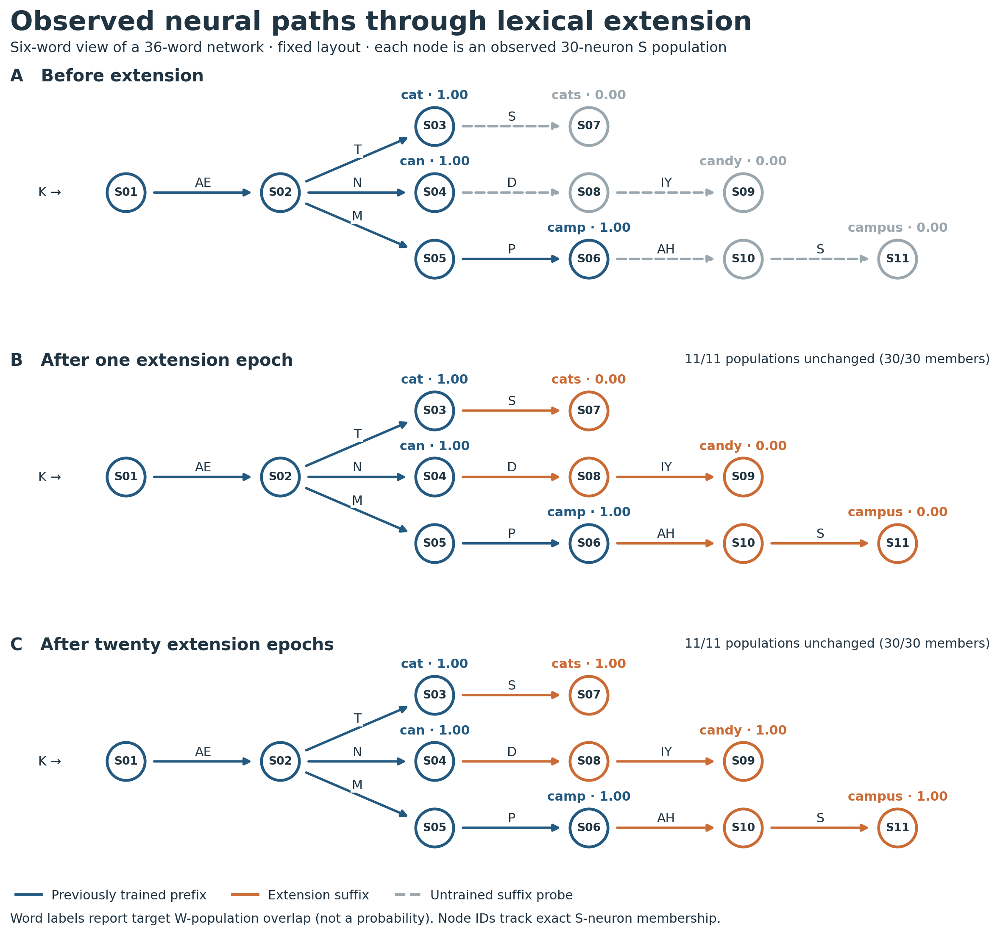
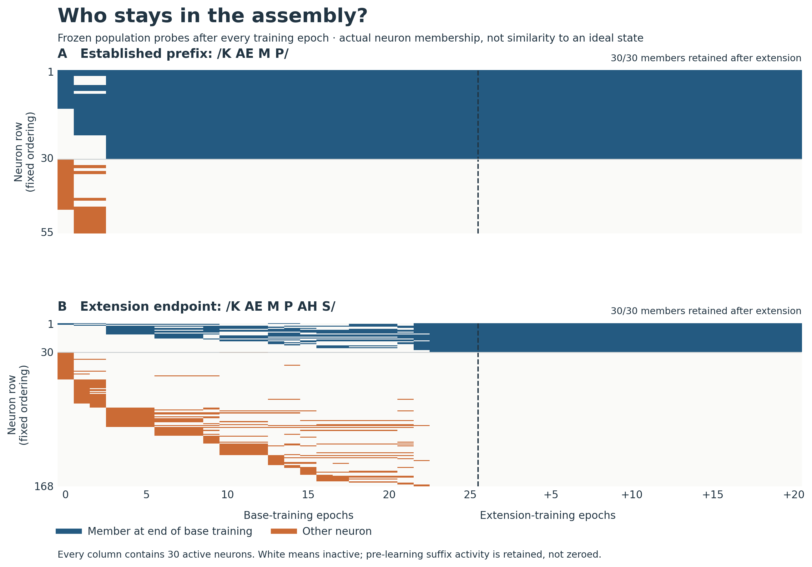
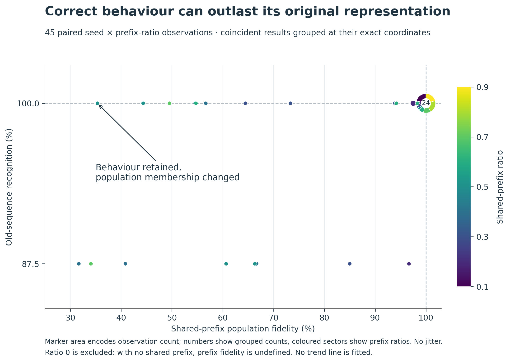

# Seeing the four-area model: paths, neurons, and behavioural retention

Date: 2026-09-22. Three new figures built from measured populations and saved per-seed results. These complement the accuracy curves; they do not replace them.

## 1. Observed neural paths through lexical extension



**What we are doing.** We replay six related words—cat/cats, can/candy, and camp/campus—at three checkpoints: after base training, after one extension epoch, and after twenty extension epochs. Each node is an actual 30-neuron S population. Identical neuron sets receive the same ID; histories with identical sets would be collapsed to one node. Phoneme histories determine a fixed, readable layout, not population identity. Each arrow records an observed transition under its labelled input, rather than a synaptic connection.

Blue marks previously trained prefixes. Grey dashed paths are frozen probes of suffixes that have not yet been trained, and orange marks suffixes after extension training. Orange does **not** mean newly created neurons or necessarily a newly created assembly. The panel annotations count unchanged populations, each retaining 30/30 members. The number beside each word reports overlap with its target W assembly, not a probability or a top-1 accuracy score.

**What it shows.** In this seed, all eleven displayed S populations retain the same members across these checkpoints—including the suffix populations. The extension therefore does not grow new nodes in this particular observed graph. The W overlap for cats, candy, and campus is 0.00 before extension and after one extension epoch, then 1.00 after twenty epochs; cat, can, and camp remain at 1.00 throughout. It trains on paths the network could already traverse, while the word readout records how those paths become associated with their terminal targets. Untrained suffix activity has deliberately not been erased.

**Why it is useful.** This makes “reuse” directly inspectable and separates changes in output association from changes in internal state identity. It also corrects a tempting but unsupported visual story: new words do not necessarily require newly appearing populations. The three panels are a measured local view, not proof that the entire network is unchanged or that it recovered a minimal DFA.

[PDF](structure_figures_2026_09_22/01_observed_machine.pdf) · [SVG](structure_figures_2026_09_22/01_observed_machine.svg)

## 2. Who stays in the assembly?



**What we are doing.** We record a frozen clean replay after every epoch, plus an untrained checkpoint. Columns are checkpoints; rows are individual neurons in a fixed ordering. The upper panel shows the population reached after /K AE M P/; the lower panel shows /K AE M P AH S/. The dashed line separates 25 base-training epochs from 20 extension-training epochs. These are epoch-by-epoch probes, not continuous spike recordings or every training presentation.

Blue neurons belong to the population observed at the end of base training; orange neurons are other neurons observed at some checkpoint. Rows are ordered once: the 30 reference members first, followed by other observed neurons in order of first appearance, with neuron ID breaking ties. Rows never move between columns. Every column has exactly 30 active neurons. White means inactive, not an absent neuron.

**What it shows.** Across the full recording, 55 different neurons participate in the camp endpoint and 168 in the campus endpoint. Both retain all 30 pre-extension members at the final checkpoint. In this example, most visible membership change occurs during base training; campus is only probed, not taught, during that phase. Shared network weights can change the response to an untrained sequence. By extension training, these populations are already stable in the clean probes.

**Why it is useful.** This gives concrete meaning to a state assembly: it is a traceable population of particular neurons, not just a label or a point in an embedding. It reveals turnover hidden by a single final-overlap number, while avoiding the misleading claim that untrained suffixes have no representation. The two panels have different numbers of rows; compare membership patterns, not coloured area between panels.

[PDF](structure_figures_2026_09_22/02_neuron_membership.pdf) · [SVG](structure_figures_2026_09_22/02_neuron_membership.svg)

## 3. Correct behaviour can outlast its original representation



**What we are doing.** We replot the saved four-area structural-reuse sweep as paired observations. The horizontal axis is mean shared-prefix S overlap between the original base trajectory and the post-extension trajectory. The vertical axis is recognition of the eight old sequences after extension. Each of five seeds contributes a point at each of nine nonzero prefix ratios: 45 observations. Ratio zero is excluded because there is no shared prefix to measure.

Exactly coincident observations are combined at their true coordinates. Marker area is proportional to their count, coloured sectors show their prefix-ratio composition, and the largest group is labelled with its count. There is no jitter or fitted trend. In particular, 24 observations coincide at 100% fidelity and 100% retention; they should not look like one experiment.

**What it shows.** Thirteen conditions retain 100% old-sequence recognition despite non-identical shared-prefix populations. One condition has only 35.3% prefix fidelity while all eight old sequences remain correctly recognised. At ratio 0.4, mean retention is 92.5% while mean prefix fidelity is 50.1%; at ratio 0.8, both are 100%.

**Why it is useful.** This directly supports the reason for measuring internal structure: behavioural retention and population preservation are different properties. High recognition alone cannot establish exact structural reuse. Conversely, population change need not imply behavioural failure. This is a pairing of whole-old-set behaviour with one shared-prefix trajectory metric, not evidence that every changed neuron is behaviourally irrelevant.

[PDF](structure_figures_2026_09_22/03_behaviour_vs_structure.pdf) · [SVG](structure_figures_2026_09_22/03_behaviour_vs_structure.svg)

## Provenance and interpretation

Figures 1–2 use a newly recorded, physically four-area run with seed 41100, N = 2000, k = 30, core β = 0.003, β_W = 0.40, and the matched CMUdict protocol from the context diagnosis: 28 base words for 25 epochs, followed by eight extension words for 20 epochs. Only six word trajectories are displayed, but training uses the full vocabulary. This is one preselected illustrative seed, not a multi-seed estimate. Prefix plasticity is externally gated off during extension. Probes disable both plasticity and normalization, clear activity before each word, and never teach an output.

Figure 3 uses the existing `data/four_area_structural_reuse_clean.json`, with seed order 101, 202, 303, 404, 505 verified against its generating script. This is a separate synthetic benchmark: eight length-20 sequences, alphabet size 12, six base epochs, and a separately restored base network for each prefix ratio. Extension training stops at first correct extension classification or after twelve presentations. Ratios are not successive stages of one continually growing network. Retention is measured on eight old sequences against nine candidate labels. The original evaluator disables plasticity but does not explicitly disable normalization; this figure faithfully replots its saved measurements rather than silently changing that protocol.

Do not combine these figures into a claim of universal state preservation, autonomous novelty detection, or proof of attractor basins. The useful result is the ability to inspect what is preserved, what changes, and how that relates to behaviour.

## Reproduction and files

Repository: `/home/johnh/Documents/ac-fsm-learning`.

```sh
OPENBLAS_NUM_THREADS=1 OMP_NUM_THREADS=1 MPLCONFIGDIR=/tmp/ac-structure-mpl PYTHONDONTWRITEBYTECODE=1 python make_structure_figures.py capture
OPENBLAS_NUM_THREADS=1 MPLCONFIGDIR=/tmp/ac-structure-mpl PYTHONDONTWRITEBYTECODE=1 python make_structure_figures.py render
OPENBLAS_NUM_THREADS=1 MPLCONFIGDIR=/tmp/ac-structure-mpl PYTHONDONTWRITEBYTECODE=1 python make_structure_figures.py validate
```

Outputs are under `results/structure_figures_2026_09_22/`: PNG previews, PDF/SVG publication exports, compressed population probes, a capture manifest, exact figure measurements (including neuron IDs and all paired scatter points), and validation results. The capture uses the existing ablation helper and sibling PYAC source. The helper and dictionary are covered by existing repository ignore rules; preserve those dependencies when packaging the experiment. Original results notes and figures were not overwritten.
